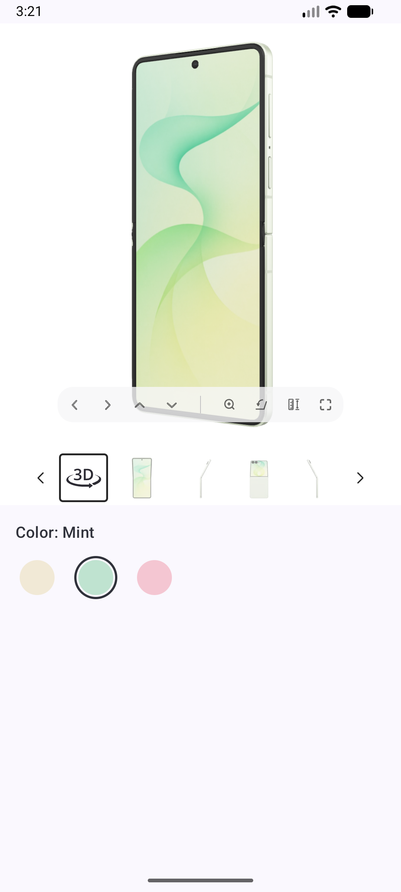

# Binkies 3D viewer in an Android app (Kotlin / Jetpack Compose)

This example shows how to put the Binkies 3D viewer on a product screen of a native Android app.
The viewer is a web page that runs inside a `WebView`. The app and the page talk to each other through a small bridge:

- The app tells the page what to show, e.g. which product (`window.binkies.setSettings(...)`).
- The page asks the app for these settings when it starts, tells it whether the product has a 3D model, and reports its errors (`BinkiesNative.postMessage(...)`).



| File                                                                               | What it is                                                                                                       |
| ---------------------------------------------------------------------------------- | ---------------------------------------------------------------------------------------------------------------- |
| [`BinkiesViewer.kt`](app/src/main/java/com/example/kotlinexample/BinkiesViewer.kt) | The reusable part: the `BinkiesViewer` composable, `BinkiesSettings` and the bridge. Copy this file to your app. |
| [`MainActivity.kt`](app/src/main/java/com/example/kotlinexample/MainActivity.kt)   | Only the demo around it: `ProductScreen` and `ColorSelector`.                                                    |

## Run the example

1. Open the project in Android Studio (or use `./gradlew installDebug`).
2. Run the `app` configuration on a device or emulator (minSdk 24).
3. Pick a color: Cream and Mint have a 3D model and the viewer slides open. Pink has no model, so the viewer stays collapsed and the label shows "(no 3D)".

## Add it to your app

1. Add the internet permission to `AndroidManifest.xml`:

   ```xml
   <uses-permission android:name="android.permission.INTERNET" />
   ```

2. Copy `BinkiesViewer.kt` to your app, change its `package` line to your package, and set `VIEWER_URL` to the viewer page you got from Binkies.

3. Use it on your product screen:

   ```kotlin
   // null until the page answers, then true (has 3D) or false (no 3D)
   var visible by remember { mutableStateOf<Boolean?>(null) }

   BinkiesViewer(
       settings = BinkiesSettings(product = productId), // Binkies content id of the selected variant
       visible = visible == true,
       onVisibilityChange = { visible = it },
       onError = { message -> /* optional, e.g. forward to your crash reporting */ },
   )
   ```

   When the settings change (e.g. another `productId`), the viewer updates without reloading the page.
   Keep `visible` in your screen state if other UI depends on it, e.g. a "3D" badge.

That's all. You don't need to wait for the page or keep track of what it already got: `BinkiesViewer` sends the settings when the page asks for them, and again whenever they change.

## How it works

```
App                                              Page (WebView)
 │  loadUrl(VIEWER_URL)                            │
 │ ──────────────────────────────────────────────▶ │
 │                  {"type":"setSettings"}         │  window.binkies is ready
 │ ◀────────────────────────────────────────────── │
 │  window.binkies.setSettings({all settings})     │
 │ ──────────────────────────────────────────────▶ │  starts loading the product
 │                  {"type":"show"} or "hide"      │
 │ ◀────────────────────────────────────────────── │
 │  window.binkies.setSettings({all settings})     │  user picks another variant
 │ ──────────────────────────────────────────────▶ │
 │                  {"type":"show"} or "hide"      │  only if it changed
 │ ◀────────────────────────────────────────────── │
 │                {"type":"error", ...}            │  whenever the page logs an error
 │ ◀────────────────────────────────────────────── │
```

### Messages from the page

The page calls `window.BinkiesNative.postMessage(json)`. The app registers that object with `addJavascriptInterface` **before** `loadUrl`, because the page posts as soon as it starts (it asks for its settings right away).

| Message                                          | Meaning                                                                                                                                                                             | What the app does                                                  |
| ------------------------------------------------ | ----------------------------------------------------------------------------------------------------------------------------------------------------------------------------------- | ------------------------------------------------------------------ |
| `{"type":"setSettings"}`                         | The page is ready for its settings. Sent once per page load, as soon as the page starts.                                                                                            | Sends the current settings.                                        |
| `{"type":"show"}`                                | The selected product's 3D model has loaded.                                                                                                                                         | Expands the viewer.                                                |
| `{"type":"hide"}`                                | The selected product has no 3D model, or the device can't render 3D (no WebGL2).                                                                                                    | Collapses the viewer.                                              |
| `{"type":"error","message":"...","stack":"..."}` | The page logged an error: `console.error`, an uncaught error, an unhandled promise rejection or a failed script/image load. `stack` is only there when there was an `Error` object. | Logs it with `Log.e` under the `Binkies` tag, and calls `onError`. |

`show` and `hide` are only sent when the visibility changes. Switching from Cream to Mint sends nothing, because both have 3D.
The page remembers the answer per product, so switching back to a product answers right away.

`@JavascriptInterface` methods run on a WebView background thread, so `onBridgeMessage` posts each message to the main thread before it touches Compose state.

### Settings sent to the page

`BinkiesViewer` always sends all settings, never only the changed ones: when the page asks for them (`setSettings`), and whenever `settings` changes (`BinkiesSettings` is a data class, so only real changes count). It doesn't need to know whether the page is loaded: until the page is ready, `window.binkies` doesn't exist and the call (`window.binkies?.setSettings(...)`) does nothing. The page then asks for the current settings. If the page reloads, it asks again.

| `BinkiesSettings`         | Page setting                       | Type                                             | Default             | Description                                |
| ------------------------- | ---------------------------------- | ------------------------------------------------ | ------------------- | ------------------------------------------ |
| `product`                 | `product`                          | `String`                                         | required            | Binkies content id of the product to show. |
| `thumbnailsPlacement`     | `gallery.thumbnails.placement`     | `ThumbnailsPlacement`: `Bottom`, `Left`, `Right` | `Bottom`            | Where the thumbnail strip is placed.       |
| `thumbnailsSelectedColor` | `gallery.thumbnails.selectedColor` | Compose `Color`                                  | `Color(0xFF262626)` | Border color of the selected thumbnail.    |

Because of the enum and the `Color` type, the app can't send an invalid placement or color. The page still validates the settings strictly: unknown keys and invalid values are rejected, and the previous settings stay in place.
`evaluateJavascript` doesn't report JavaScript errors back to Kotlin, so `setSettings` catches them and logs them with `console.error`. The page sends that back as an `error` message, which ends up in logcat under the `Binkies` tag and in `onError`.

To use a new setting of the page, add a field with a default value to `BinkiesSettings` and put it into `toJson()`.

## Things to keep in mind

- **Set the WebView's layout params to `MATCH_PARENT`.** `AndroidView` adds the view with `WRAP_CONTENT` layout params. With a `WRAP_CONTENT` height, Android's WebView lays the page out against a zero-height viewport, so the viewer collapses and you only see the thumbnail strip. `createWebView` sets `MATCH_PARENT`, and Compose still decides the real size.
- **Don't hide the WebView with `GONE`/`INVISIBLE`.** A WebView that isn't visible pauses the page, so the next model never finishes loading and `show` never arrives. `BinkiesViewer` instead animates the height of a clipping `Box` around it. The WebView itself always keeps its full height (`wrapContentHeight(unbounded = true)` + `requiredHeight`), so the page is never resized while it opens or closes.
- **Pass the lifecycle on.** `BinkiesViewer` calls `onPause()`/`onResume()` with the screen's lifecycle, so the 3D rendering stops in the background. It also calls `destroy()` when the viewer leaves the composition.
- **Configuration changes reload the page.** The WebView lives as long as the composable, so rotating the device recreates it. The new page asks for the settings again and gets the current ones, and `visible` starts over until the next `show`/`hide`.
- **Viewer size.** The example uses the full width and a 5:6 aspect ratio (`maxWidth * 1.2f`), which fits the model with the thumbnails below it. Change `viewerHeight` to fit your layout.

## Debugging

- Debug builds call `WebView.setWebContentsDebuggingEnabled(true)`. Open `chrome://inspect` in desktop Chrome to get DevTools for the page.
- Bridge messages are logged under the `Binkies` tag, page errors with `Log.e`: `adb logcat -s Binkies chromium`.
- On the page you can call `window.binkies.setSettings({...})` from the DevTools console and read the current settings from `window.binkies.settings`.
